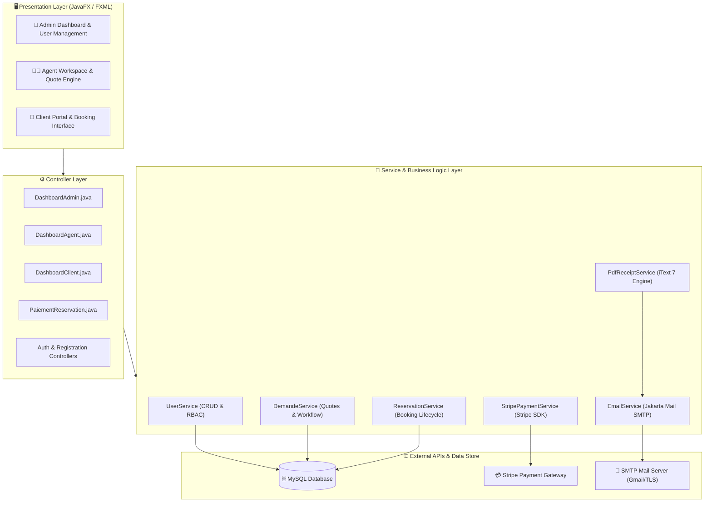

# ✈️ TravelCustom-JavaFX-Platform
### Tailor-Made Travel & Booking Management System | Plateforme de Gestion de Voyages Personnalisés

[](https://www.oracle.com/java/)
[](https://openjfx.io/)
[](https://www.mysql.com/)
[](https://stripe.com/)
[](https://itextpdf.com/)
[](https://eclipse-ee4j.github.io/mail/)
[](https://maven.apache.org/)
[](LICENSE)

---

## 📌 Overview / Présentation du Projet

**TravelCustom-JavaFX-Platform** is an enterprise-grade desktop application designed for travel agencies specializing in tailor-made (*à la carte*) journeys. It streamlines the entire custom travel lifecycle: from customer trip requests and preferences submission, agent quotation and validation, to **secure online Stripe payment**, **automated PDF receipt generation**, and **transactional email notifications**.

Développée avec une architecture modulaire **MVC (Model-View-Controller) / Service-DAO**, l'application garantit une séparation stricte des responsabilités, un contrôle de saisie rigoureux (Jakarta Validation) et une expérience utilisateur soignée grâce à des interfaces FXML modernes.

---

## 🏗️ System Architecture / Architecture Technique



---

## ✨ Key Features / Fonctionnalités Clés

### 👑 1. Espace Administrateur (Back-Office)
* **Tableau de Bord Décisionnel :** Métriques en temps réel (nombre total d'utilisateurs, demandes en attente, réservations confirmées, chiffre d'affaires).
* **Gestion des Utilisateurs (CRUD complet) :** Création, modification, filtrage et révocation des comptes (Admins, Agents, Clients).
* **Supervision Globale :** Suivi centralisé de tous les flux et états d'avancement des dossiers.

### 👨‍💼 2. Espace Agent de Voyage
* **Triage des Demandes :** Consultation des demandes entrantes avec dates, destinations et souhaits spécifiques.
* **Élaboration de Devis & Personnalisation :** Prise en charge des dossiers, calcul du prix et validation avec statut dynamique.
* **Conversion en Réservation :** Génération instantanée du dossier de réservation client.

### 👤 3. Espace Client (Front-Office)
* **Création de Voyages sur Mesure :** Formulaire dynamique (destination, période, budget, préférences touristiques).
* **Suivi en Temps Réel :** Indicateurs visuels colorés selon l'état de validation (`en_attente`, `validee`, `refusee`, `confirmee`).
* **Paiement & Facturation :** Accès direct à la plateforme de paiement et téléchargement du reçu.

---

## 🚀 Advanced Integrations / Points Forts Techniques

| Module | Technologie | Description |
| :--- | :--- | :--- |
| **Paiement Sécurisé** | **Stripe SDK Java (v26)** | Intégration de l'API Stripe Checkout / PaymentIntent permettant de régler les réservations validées par carte bancaire. |
| **Génération PDF** | **iText 7 (Kernel & Layout)** | Création automatisée et instantanée de factures / vouchers de réservation avec logo, métadonnées, dates et récapitulatif financier. |
| **Notification Mail** | **Jakarta Mail (SMTP)** | Envoi automatique d'un email transactionnel au client dès la confirmation du paiement avec son reçu PDF attaché. |
| **Validation des Données** | **Hibernate Validator** | Validation déclarative des formulaires (formats d'emails, longueur des mots de passe, intégrité des dates). |
| **Contrôle d'Accès** | **RBAC & SessionManager** | Gestion d'état utilisateur en session assurant l'isolation stricte des privilèges entre rôles. |

---

## 🛠️ Stack Technique

* **Langage :** Java 17 LTS
* **IHM / UI :** JavaFX 17 (FXML), ControlsFX, BootstrapFX
* **Base de Données :** MySQL 8.0+ / MariaDB (JDBC Connector 8.0.33)
* **Moteur PDF :** iText 7.8
* **API de Paiement :** Stripe Java SDK
* **Messagerie :** Jakarta Mail 2.0 (TLS/SMTP)
* **Gestionnaire de dépendances :** Apache Maven 3.9+

---

## 🚀 Installation & Démarrage Rapide

### Prérequis
* **JDK 17** ou version ultérieure installé ([Télécharger OpenJDK](https://adoptium.net/)).
* **MySQL** (ex: via XAMPP, WampServer ou Docker).
* **Git** et **Maven** (inclus via wrapper `mvnw`).

### 1. Cloner le projet
```bash
git clone https://github.com/slimmessai20-lgtm/TravelCustom-JavaFX-Platform.git
cd TravelCustom-JavaFX-Platform
```

### 2. Importer la Base de Données
Dans votre outil de base de données (phpMyAdmin, MySQL Workbench ou terminal) :
```bash
mysql -u root -p -e "CREATE DATABASE IF NOT EXISTS voyages;"
mysql -u root -p voyages < database.sql
```

### 3. Variables d'Environnement (Optionnel)
Pour activer les envois réels d'emails et l'API Stripe en mode sandbox :
```bash
# Sous Windows (PowerShell) :
$env:STRIPE_API_KEY="sk_test_votre_cle_stripe"
$env:SMTP_EMAIL="votre_email@gmail.com"
$env:SMTP_PASSWORD="votre_mot_de_passe_application"

# Sous Linux / macOS :
export STRIPE_API_KEY="sk_test_votre_cle_stripe"
export SMTP_EMAIL="votre_email@gmail.com"
export SMTP_PASSWORD="votre_mot_de_passe_application"
```

### 4. Lancer l'application
```bash
# Avec le wrapper Maven (Windows) :
.\mvnw clean javafx:run

# Sous Linux / macOS :
./mvnw clean javafx:run
```

---

## 🔑 Comptes de Démonstration (Pré-configurés)

| Rôle | Email | Mot de Passe |
| :--- | :--- | :--- |
| 👑 **Administrateur** | `admin@voyages.com` | `admin123` |
| 👨‍💼 **Agent de Voyage** | `agent@voyages.com` | `agent123` |
| 👤 **Client** | `client@voyages.com` | `client123` |

---

## 📁 Structure du Projet

```text
TravelCustom-JavaFX-Platform/
├── src/main/
│   ├── java/
│   │   ├── controllers/      # Contrôleurs JavaFX (Dashboards, Auth, Paiement, CRUD)
│   │   ├── entities/         # Entités métier (User, Demande, Reservation, Role)
│   │   ├── services/         # Services métier (Stripe, Email, PdfReceipt, CRUD DB)
│   │   ├── utils/            # Connexion DB (MyDatabase.java) & SessionManager
│   │   └── org/voyages/      # Point d'entrée de l'application (Launcher.java)
│   └── resources/
│       └── org/voyages/voyages/ # Vues FXML (Interfaces graphiques & formulaires)
├── database.sql              # Script DDL + données de démonstration
├── pom.xml                   # Dépendances Maven (JavaFX, Stripe, iText, Mail)
├── .gitignore                # Exclusion des fichiers temporaires et secrets
└── README.md                 # Documentation du projet
```

---

## 👨‍💻 Auteur

**Slim Messai**  
*Élève Ingénieur en Télécommunications & Technologies Numériques*  
* Spécialisations : IoT, Architecture Logicielle, Systèmes Embarqués & IA  
* **GitHub :** [@slimmessai20-lgtm](https://github.com/slimmessai20-lgtm)

---

## 📄 Licence
Ce projet est sous licence MIT - voir le fichier [LICENSE](LICENSE) pour plus de détails.
